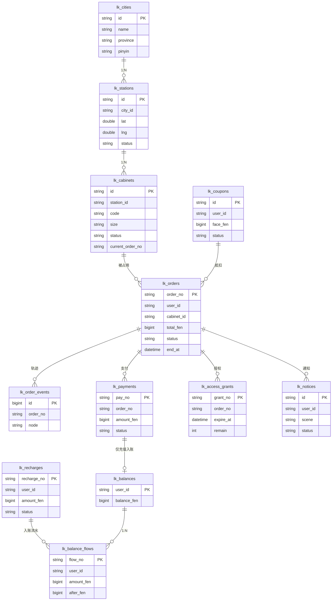
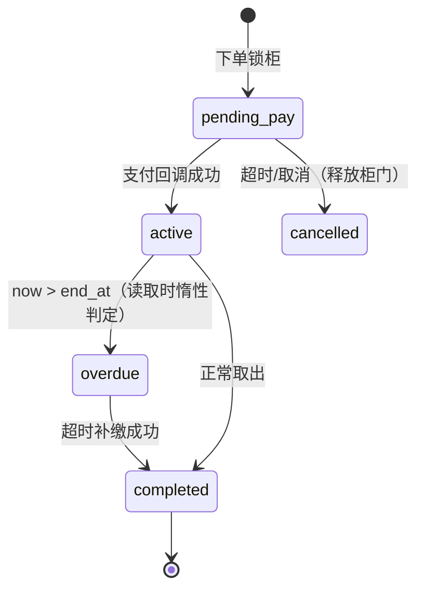
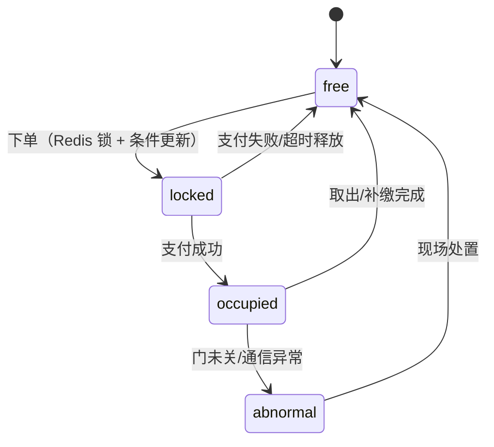

# ER 图与状态机

## 1. 实体关系

关键约束：

1. 一条订单同一时刻只能绑定一个柜门；一个柜门同一时刻只能被一条有效订单占用（`lk_cabinets.current_order_no` 唯一有效）。
2. 支付记录与订单为多对一，允许因重试产生多条，但同一订单同一时刻只有一条 `success` 记录。
3. 余额明细是资金唯一可信来源，`lk_balances.balance_fen` 是明细聚合结果（与需求分析 5.2 一致）。

## 2. 订单状态机

| 状态 | 含义 | 允许动作 | 迁移条件 |
| --- | --- | --- | --- |
| pending_pay | 已锁柜未支付 | 支付回调 | 回调成功 → active；失败 → 保持/取消 |
| active | 寄存中 | 取出、授权、查看 | 取件成功 → completed；到期 → overdue |
| overdue | 超时欠费 | 补缴 | 补缴成功 → completed（解锁取件） |
| completed | 已取件结清 | 查看详情 | 终态 |
| cancelled | 未支付终止 | 查看 | 终态，柜门释放 |

## 3. 柜门状态机

柜门状态只能由 `repo` 的条件更新修改：`UPDATE lk_cabinets SET status=?, current_order_no=?, version=version+1 WHERE id=? AND status=? AND version=?`，返回影响行数为 0 即判定并发冲突。

## 4. 支付与充值状态

| 对象 | 状态 | 说明 |
| --- | --- | --- |
| 支付记录 | processing | 下单后生成，等待回调 |
| 支付记录 | success | 回调成功且金额校验通过 |
| 支付记录 | failed / abnormal | 回调失败或金额不符，记录异常流水 |
| 充值记录 | processing → success | 与余额明细一一对应，重复回调不重复入账 |

## 5. 幂等设计

| 场景 | 幂等键 | 介质 | 失效兜底 |
| --- | --- | --- | --- |
| 支付回调 | 客户端传入 `idempotency_key`（缺省用 `pay_no`） | Redis `lk:idem:pay:*` SETNX + `lk_payments` 唯一索引 | 已存在则直接返回 `duplicated=true` |
| 充值回调 | `idempotency_key`（缺省用 `recharge_no`） | Redis `lk:idem:recharge:*` + 唯一索引 | 同上 |
| 下单锁柜 | 柜门 ID | Redis `lk:cabinet:<id>` SETNX，TTL 20s | 数据库条件更新 + 版本号 |
| 授权核销 | 授权号 | 数据库条件更新 `remain > 0` | 影响行数判定 |
