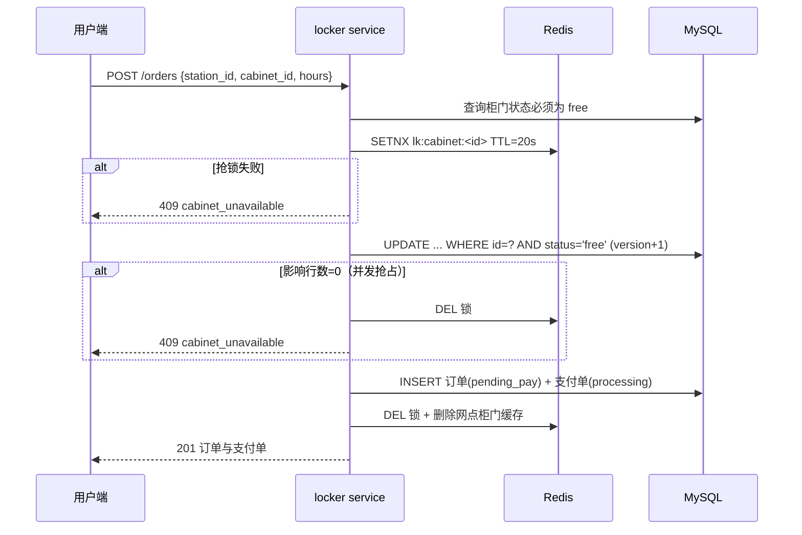

# 设计说明书

## 1. 设计目标

在 `bw-cli` 脚手架（Go + Gin + Gorm + Redis + zap）之上，落地《智能快寄柜系统需求分析说明书》中 HM / DP / PY / OD / UC / MS 六个模块的可运行能力，形成一条**不依赖外部服务**的完整链路：城市与网点发现 → 费用试算 → 下单锁柜 → 支付回调 → 订单查看 → 取出与超时补缴 → 临时授权 → 余额充值 → 个人中心 → 消息通知。

## 2. 与脚手架的适配

| 脚手架约定 | 本项目做法 | 理由 |
| --- | --- | --- |
| 服务按 `internal/<domain>/{dto,entity,model,repo,service,handler}` 分层 | 新增 `internal/locker` 同构分层 | 完全沿用依赖方向 `handler → service → repo → model/entity` |
| 微服务以 gRPC 暴露，gateway 转发 | locker 作为**进程内 HTTP 模块**挂到 gateway 的 `/api/v1/locker` | 工单只要求功能闭环；避免额外 proto 生成与多进程编排，且 `pkg/httpx`、`pkg/errors`、`pkg/middleware` 可直接复用 |
| 配置集中在 `configs/config.yaml` + `pkg/config` | 新增 `locker:` 配置段与 `LockerConfig`，DSN/Redis 支持环境变量覆盖 | 计费与并发参数可调，密码不落库 |
| 数据库由 `pkg/database.Open` 统一构建 | bootstrap 内 `AutoMigrate` + 幂等种子数据 | 起服务即建表，无需手工 DDL |

改造点只有三处，其余为新增文件：

1. `internal/gateway/router/router.go`：`New` 增加 `lockerHandler` 参数。
2. `internal/gateway/router/v1.go`：注册 `registerLockerRoutes`。
3. `cmd/gateway/main.go`：装配 `bootstrap.New`，并支持 `BW_MYSQL_DSN` / `BW_REDIS_ADDR` 环境变量覆盖。

## 3. 目录结构

```
internal/locker/
├── bootstrap/bootstrap.go   # DB 迁移、Redis 连接、种子数据、依赖装配
├── dto/dto.go               # 请求/响应结构，金额 int64 分，时间 RFC3339
├── entity/entity.go         # 状态常量、计费规则、领域错误
├── handler/http.go          # 22 个 HTTP 接口，统一 httpx 外壳
├── model/models.go          # 13 张 lk_ 前缀 Gorm 模型
├── repo/repo.go             # Gorm 读写 + Redis 缓存/柜门锁/幂等
└── service/service.go       # 业务用例与错误映射
internal/gateway/router/locker_routes.go  # 路由挂载
```

## 4. 关键流程

### 4.1 下单锁柜（防超卖）



Redis 锁解决"同一时刻大量请求同时看到 free"，数据库条件更新解决"锁过期后的残留竞争"，两层都不依赖单点。

### 4.2 支付回调幂等

1. 先按 `pay_no` 取支付单，校验 `order_no` 归属与 `amount_fen`，不符直接 409 并写审计。
2. 若支付单已是 `success`，直接返回当前订单状态 + `duplicated=true`。
3. 否则以 `lk:idem:pay:<key>` SETNX 抢占幂等位；抢占失败同样返回 `duplicated=true`。
4. 成功路径：支付单 → success，柜门 `locked → occupied`，订单 `pending_pay → active`，写轨迹与站内信，清缓存。
5. 失败路径：支付单 → failed，订单 → cancelled，柜门释放为 free。

`lk_payments.idempotency_key` 唯一索引是 Redis 失效时的最后防线。

### 4.3 超时判定与补缴

- 采用**读时惰性判定**：`GET /orders` 先执行 `UPDATE lk_orders SET status='overdue' WHERE status='active' AND end_at < now`，避免引入定时任务；`GET /orders/:no` 对单条订单做同样判定并写 `overdue` 轨迹与通知。
- 补缴金额 = `ceil((now - end_at) 分钟 / 60) × 单价 × 1.5`，向下取整到分；补缴成功即释放柜门并置 `completed`。
- `active` 状态下直接取件；`overdue` 取件返回 409 `order_overdue`，强制先补缴。

### 4.4 临时开柜授权

授权与订单强绑定，默认 15 分钟、2 次；核销用条件更新 `WHERE status='active' AND remain>0 AND expire_at > now`，天然防重复核销；用尽后置 `used`，过期由读取时判定返回 409。

### 4.5 充值入账

`lk_balances` 与 `lk_balance_flows` 在同一事务内写入，余额行用 `SELECT ... FOR UPDATE` 加锁，流水记录 `before_fen/after_fen`，保证资金可追溯；重复回调由幂等键与 `status=success` 双重拦截。

## 5. 并发与性能

| 关注点 | 措施 |
| --- | --- |
| 柜门超卖 | Redis SETNX + DB 条件更新 + version 列 |
| 回调重复入账 | Redis 幂等键 + 唯一索引 + 状态短路 |
| 券重复使用 | `UPDATE ... WHERE status='unused'` 条件更新 |
| 列表查询 | `user_id`、`status`、`created_at` 建索引，分页上限 100 |
| 热点读 | 网点柜门列表 60s 缓存，变更即失效 |
| Redis 故障 | 启动仅告警不阻断；锁与缓存自动降级为 MySQL 条件更新 |

## 6. 配置与运行

```yaml
database:
  driver: mysql
  dsn: "root:root@tcp(127.0.0.1:3306)/bw_locker?charset=utf8mb4&parseTime=True&loc=Local"
redis:
  addr: 127.0.0.1:6379
locker:
  price_s_fen: 300
  price_m_fen: 450
  price_l_fen: 600
  deposit_s_fen: 1000
  deposit_m_fen: 1500
  deposit_l_fen: 2000
  overdue_rate: 1.5
  cabinet_lock_ttl_seconds: 20
  cache_ttl_seconds: 60
  grant_ttl_minutes: 15
  grant_max_uses: 2
```

运行：

```powershell
go run ./cmd/gateway            # 默认读取 configs/config.yaml
$env:BW_MYSQL_DSN="user:pass@tcp(127.0.0.1:3306)/bw_locker?charset=utf8mb4&parseTime=True&loc=Local"
$env:BW_REDIS_ADDR="127.0.0.1:6379"
go run ./cmd/gateway
```

启动即 `AutoMigrate` 13 张表并写入演示数据（3 城市 / 3 网点 / 22 柜门 / 3 张券 / 余额 5000 分）。

## 7. 需求到代码的映射

| 需求编号 | 需求 | 落地位置 |
| --- | --- | --- |
| FR-HM-01 | 城市定位与选择 | `service.Cities`、`GET /cities`、`GET /stations?lat&lng` |
| FR-HM-02 | 附近网点与空柜查询 | `service.Stations`（距离升序、free_count） |
| FR-DP-01 | 费用试算 | `service.Quote`、`entity.Rent/Deposit/CouponDiscount` |
| FR-DP-02 | 下单锁柜 | `service.CreateOrder`、`repo.LockCabinet`、Redis `lk:cabinet:*` |
| FR-DP-03 | 支付回调 | `service.PayNotify`、`repo.MarkIdempotent` |
| FR-OD-01 | 当前/历史订单 | `service.ListOrders`、`repo.ExpireActiveOrders` |
| FR-OD-02 | 订单详情与轨迹 | `service.OrderDetail`、`lk_order_events` |
| FR-OD-03 | 取出物品 | `service.Pickup`、`repo.FreeCabinet` |
| FR-OD-04 | 超时计费与补缴 | `service.OverduePay`、`entity.OverdueFee` |
| FR-OD-05 | 临时开柜授权 | `service.CreateGrant/UseGrant`、`lk_access_grants` |
| FR-PY-01 | 余额与明细 | `service.Balance/Flows`、`lk_balances`、`lk_balance_flows` |
| FR-PY-02 | 充值回调入账 | `service.CreateRecharge/RechargeNotify` |
| FR-UC-01 | 个人中心 | `service.Profile` |
| FR-UC-02 | 卡券列表 | `service.Coupons`、`entity.CouponDiscount` |
| FR-MS-01 | 站内信列表/已读 | `service.Notices/ReadNotice`、`service.notify` |

未实现项（P2：数字人 07、性能工具链 08、IDE Skills 09、运维智能体 10）按 `01-需求映射与范围.md` 的裁剪结论保留为后续迭代，不在本次代码范围内。

## 8. 交付物清单

| 交付物 | 路径 |
| --- | --- |
| Agent 规范 | `AGENTS.md`（仓库根目录） |
| 需求映射与范围 | `docs/locker/01-需求映射与范围.md` |
| 数据字典 | `docs/locker/02-数据字典.md` |
| ER 与状态机 | `docs/locker/03-ER与状态机.md` |
| 接口文档（22 个） | `docs/locker/04-接口文档.md` |
| 设计说明书 | `docs/locker/05-设计说明书.md` |
| 接口测试报告 | `docs/locker/06-接口测试报告.md` |
| 测试证据 | `docs/locker/test-evidence/*.json` |
| 测试脚本 | `scripts/locker-api-test.ps1` |

